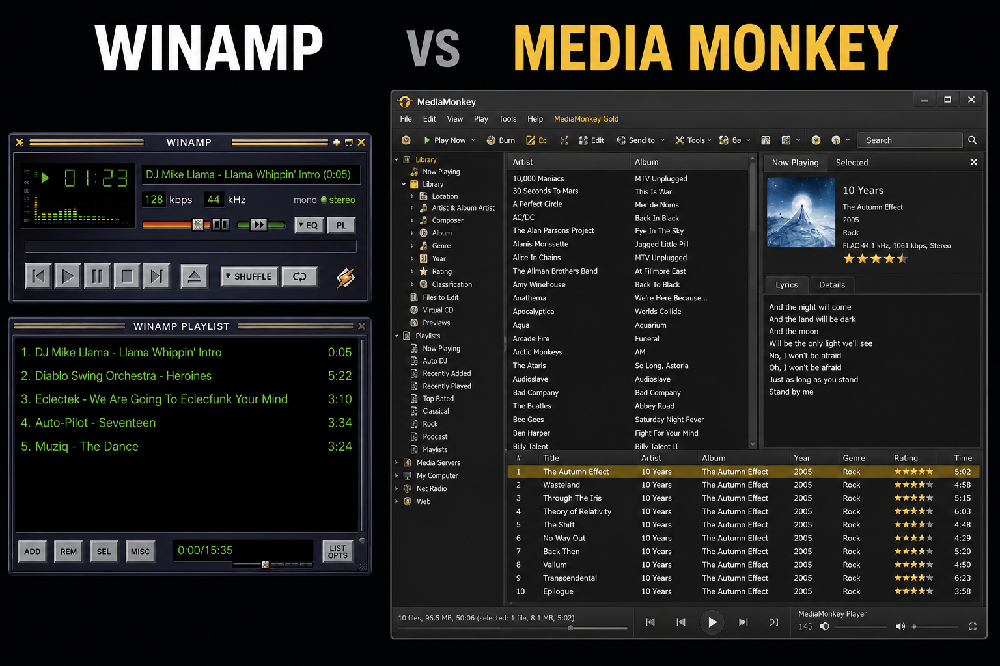
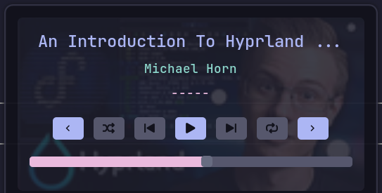
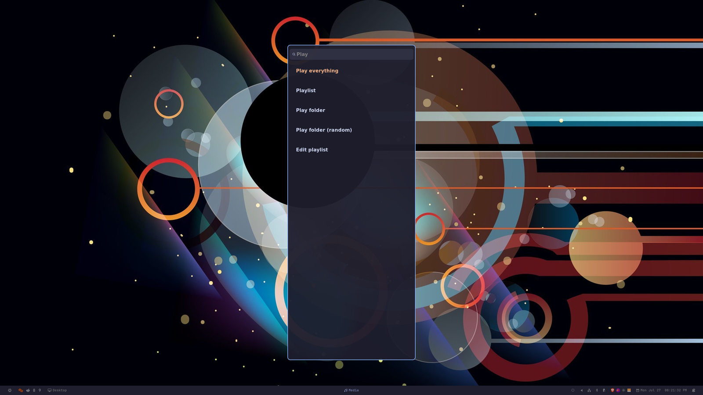
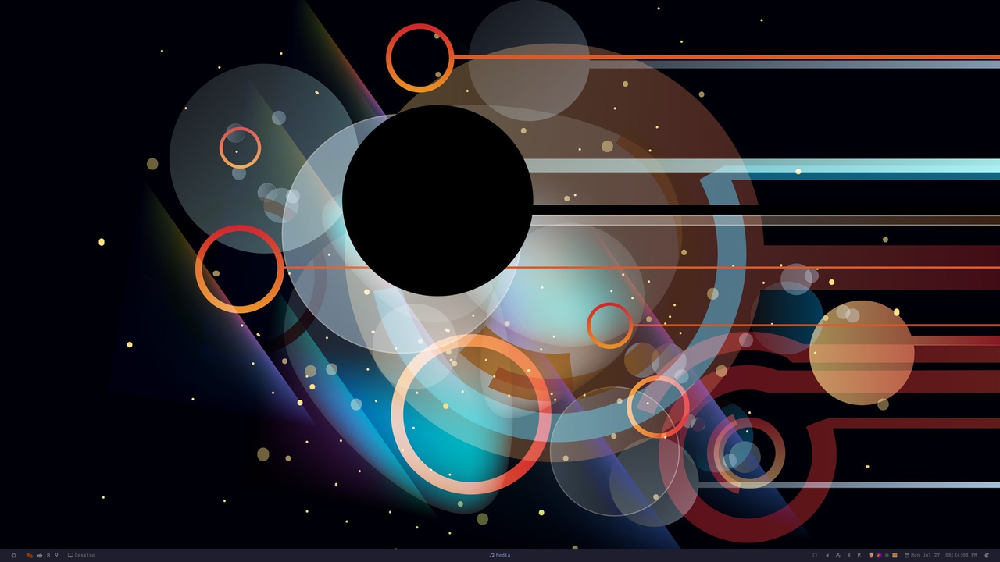

#+TITLE: Playing music on Hyprland like it's the 2000s
#+AUTHOR: Ioannis Canellos
#+DATE: 2026-07-27
#+CATEGORIES:
#+TAGS: hyprland, mpd, wofi, linux, music, nixos
#+DESCRIPTION: How I got the directness of old school music players back, by letting Hyprland be the interface and MPD be the player.

* Prologue

I am old enough to have used Winamp. And XMMS after it.

I get a bit nostalgic about them. Not for nostalgia's sake, but for usability. Those players were direct. You pointed them at a folder, they played it. The controls were right there. There was no library to curate first, no import step, no waiting for something to index before you could hear a song.

Since those days I tried a lot of players. MediaMonkey, Amarok, Rhythmbox, and a few others I have forgotten. I appreciated what they were doing. The media management features were genuinely good, and my library did need managing. But the directness was gone. Playing an album became a small project.

Put them side by side and the shift speaks for itself. On the left, a player: a few buttons, a playlist, and the song. On the right, a manager: a library tree, a browser, a details pane, a toolbar, a status bar. Somewhere in there is also a play button.

That is the trade the whole category made. We went from players to managers, and paid for it in screen real estate, in memory and CPU, and mostly in complexity. Every one of those panels is a thing to learn, configure and navigate before the music starts.

So my interest in players slowly faded. For years I mostly used streaming services, which solved the library problem by not having one, but which are not direct either. Different obstacle, same distance between me and the music.

There was a second thing pushing me away, and it took me a while to name it. I use tiling window managers with multiple workspaces. A music player is yet another program that has to live in a workspace. Every time I wanted to change a playlist, skip a track, or switch to a different artist folder, I had to go find it. Leave what I was doing, jump to wherever the player was, do the thing, jump back. It is a small cost. You just pay it twenty times a day.

* Enter: Hyprland

After almost nine years on i3, I moved to [[https://hyprland.org][Hyprland]].

Hyprland gave me something i3 never did. On [[https://github.com/Jas-SinghFSU/HyprPanel][~hyprpanel~]] there is a media control that shows whatever is playing right now, with the usual buttons and a seek bar.

The part that matters is that it does not care about the source. A movie in ~mpv~, a YouTube video in the browser, music on Spotify, they all land in the same control. And when more than one thing is playing, it lets me switch between them. So I can pause whatever is making noise from any workspace, without going to find the program that started it.

This is great for switching between sources and controlling whatever is already playing. What it cannot do is start something. There is no way to hand it a folder from my library and say play this. It controls media, it does not feed it.

Feeding it my own music is what this post is about.

The interface is simple, and to be honest it reminded me of the plain old MP3 players I used to use back in the day.

That is when it hit me.

The reason I kept bouncing off music players was that I was asking one program to do two unrelated jobs. Be the thing that holds and plays my music, *and* be the thing I interact with. Hyprland was already doing the second job, and doing it better, because it is always there. No workspace to travel to.

So what if I split them? What if I could select a folder or a playlist with something like [[https://hg.sr.ht/~scoopta/wofi][~wofi~]], feed it to a server for playback, and let Hyprland provide the playback interface?

One idea led to another. ~wofi~ already does fuzzy search and it can list a filesystem, so picking a folder or a playlist should be smooth. And if the picker is just a chooser that appears and disappears, it never needs a workspace at all.

* The pieces

I ended up vibe coding a solution out of four things that each do one job:

- [[https://hyprland.org][*Hyprland*]] is the interface. Playback controls, always available, any workspace.
- [[https://www.musicpd.org][*MPD*]] is the player. It holds the queue and makes the sound. It has no window.
- [[https://hg.sr.ht/~scoopta/wofi][*wofi*]] is the file manager. It appears, I pick something, it disappears.
- [[https://neovim.io][*Neovim*]] is the playlist editor. Playlists are text files, so editing them is just editing text.

Nothing here is new. What is new, for me, is that no single one of them is "the music player". The music player is the combination, and it has no window of its own.

MPD is the right server for this because it is a daemon. It starts with my session and keeps playing whether or not anything is on screen. On NixOS it is a few lines:

#+begin_src nix
services.mpd = {
  enable = true;
  musicDirectory = "${config.home.homeDirectory}/Documents/Music";
  extraConfig = ''
    audio_output {
      type "pipewire"
      name "PipeWire Output"
    }
  '';
};

# MPRIS bridge so HyprPanel / playerctl see MPD as a controllable player.
services.mpd-mpris.enable = true;
#+end_src

That ~mpd-mpris~ line is the one that matters. MPRIS is the standard media control protocol on Linux. Once MPD speaks it, my panel shows the current track and my media keys work, without either of them knowing what MPD is. That is also what lets me switch sources. Whether the sound is coming from MPD or from a browser tab, the same controls apply.

* The picker

The picker is a shell script bound to ~SUPER+m m~. It asks what I want to play, then gets out of the way.

Five options. Play everything, pick a playlist, pick a folder, pick a folder shuffled, or edit a playlist. "Play everything" is first, so it is highlighted on open and I can just hit Enter.

Every menu is ~wofi~ in dmenu mode, which means every menu is fuzzy searchable. Here is the whole thing in motion:

The picking part is two steps, and both are the same trick.

First, on the top menu, I type ~for~. Not "folder", just ~for~. That is enough to knock the list down to the two folder options, and I arrow down to the random one. Then the folder list opens, and I type ~tri~.

Three letters, out of ninety folders, and the one I wanted is sitting at the top.

Two things make this work, and neither is clever.

The first is that the experience is always the same. One list, pick one thing. That is the entire interaction, at every level. There is no layout to parse, no panel that holds the artists while another holds the albums, no toolbar. Whatever the question is, the answer is a list and I choose from it. Nothing to learn after the first time.

The second is that it is fast because it is all keyboard. Fuzzy search means I type a few letters that are roughly right and the list collapses to what I meant. No mouse. No clicking into a tree, expanding a node, scrolling to find the album. My hands never leave the home row, and the whole thing is over in about a second.

The album is ~Bloody Hawk/Φθηνά Tricks~. Half Greek, half English, and ~tri~ found it without me touching the middle word at all. Which brings me to the part that took the longest to get right.

* Multi alphabet support

My library is not written in one alphabet. Some of it is Latin, some of it is Greek, and plenty of it, like that album, mixes both in the same name.

So fuzzy search on its own was not enough. I would open the picker, want ~Ζούγκλα~, and have to stop and think about which keyboard layout I was on. If I was on English, I had to switch. If I was on Greek and wanted ~Bloody Hawk~, switch back. Every single time. It is exactly the kind of tiny friction that makes you stop using a thing.

The alphabet should simply not matter. Type ~zoygkla~, get ~Ζούγκλα~. Type ~βεατλες~, get ~Beatles~. Never think about it again.

~wofi~ has no setting for this. But it has something better, once you notice it. From the man page:

#+begin_quote
~pre_display_cmd=COMMAND~ ... This command is only used to represent the label widget's string, and won't affect the output of the selected label.
#+end_quote

What ~wofi~ *matches* on and what ~wofi~ *shows* you are two different strings. That is the whole trick.

So each entry gets a couple of hidden search keys stapled to it, separated by tabs:

#+begin_example
Bloody Hawk<TAB>bloody hawk<TAB>βλοοδυ ηαωκ
#+end_example

The first field is the real name. The second is the name folded to Latin. The third is the name folded to Greek. ~wofi~ searches all three, so any of them can produce a hit, and then:

- ~--pre-display-cmd "cut -f1 <<< '%s'"~ means only the real name is ever drawn on screen
- piping the result through ~cut -f1~ strips the keys back off, so the rest of the script gets the original value and never knows this happened

Both keys have to be there. Folding to Latin alone only fixes the Greek-named entries. Carrying the Greek fold as well is what lets a Greek-typed query find ~Bloody Hawk~.

The folding itself is plain ~sed~, which keeps the dependency list unchanged. ~fold_case~ lowercases and strips accents first, so both alphabets start from the same baseline:

#+begin_src bash
latinize() {
  fold_case \
    | sed -e 's/θ/th/g; s/χ/ch/g; s/ψ/ps/g' \
          -e 's/α/a/g; s/β/v/g; s/γ/g/g; s/δ/d/g; s/ε/e/g; s/ζ/z/g' \
          -e 's/η/i/g; s/ι/i/g; s/κ/k/g; s/λ/l/g; s/μ/m/g; s/ν/n/g' \
          -e 's/ξ/x/g; s/ο/o/g; s/π/p/g; s/ρ/r/g; s/σ/s/g; s/τ/t/g' \
          -e 's/υ/y/g; s/φ/f/g; s/ω/o/g'
}
#+end_src

The ordering is the one thing worth knowing: the digraphs (~θ~, ~χ~, ~ψ~, which become ~th~, ~ch~, ~ps~) have to be expanded *before* the single letter pass, otherwise that pass happily rewrites the Latin letters they just produced.

The reverse direction has to make peace with the fact that Greek has fewer letters. ~b~ and ~v~ both land on ~β~, ~c~ and ~k~ both on ~κ~. It is approximate. It is also exactly what someone typing phonetically would reach for, and with fuzzy matching on top, approximate is plenty.

* Playback

Once something is playing, the picker is gone. It did its job.

From there everything lives in a Hyprland submap, so ~SUPER+m~ puts me in media mode and then it is single keys:

#+begin_src conf
submap = media

bind = , M, exec, mpd-hykr        # pick something new
bind = , O, exec, hyprpanel --toggle-window=mediamenu
bind = , P, exec, mpc toggle      # play / pause

# Skip keys stay in the submap so you can tap repeatedly.
bind = , J, exec, mpc next
bind = , K, exec, mpc prev

bind = , Return, submap, reset
bind = , Escape, submap, reset
#+end_src

The detail I like most is the last one. The actions that finish an interaction drop you out of the submap, but ~j~ and ~k~ do not, so skipping four tracks is ~SUPER+m j j j j~ rather than four separate chords.

That is the whole interface. No window. It works identically from any workspace, because the window manager is the one listening.

* Playlists are just files

The last piece is editing. MPD playlists are ~.m3u~ files, which is to say text files, so the editor is Neovim.

Picking "Edit playlist" opens one in a terminal. If the playlist does not exist yet, the script seeds it with every top level folder in my music directory, so instead of building a list from nothing I start with everything and delete down to what I want. Deleting lines in Vim is not work.

MPD normally wants song paths, not folders, so a folder based list like that would silently load nothing. Working around it is four lines:

#+begin_src bash
while IFS= read -r entry; do
  [ -z "$entry" ] && continue
  mpc add "$entry" || true
done < "$PLAYLIST_DIR/$pl.m3u"
#+end_src

Now a playlist can be a mix of folders and individual tracks, and I can write one by typing artist names into a buffer. Which is exactly what adding an artist looks like:

That is my ~Greek Rap~ list. Six artist folders, one per line. I open it, type ~Wang~ on a new line, ~:wq~, and then play the list. The queue comes back with Wang in it.

No dialog, no "add to playlist" menu, no drag and drop. It is a text file, so adding an artist is typing a name.

* Closing thoughts

What I ended up with is not a music player. It is four programs that already existed, arranged so that no one of them has to be the interface.

And the thing I actually got back is the directness. I hit ~SUPER+m m~, type three letters, and music plays. No window to find, no workspace to travel to, no thinking about which alphabet I am on. It is the Winamp feeling, except the interface is my window manager and the library is still properly managed underneath.

Was it a lot of fiddling for something that plays music? Yes. Do I use it every single day? Also yes.

The whole thing is a shell script and about a dozen lines of Hyprland config. I packaged it up as [[https://github.com/iocanel/mpd-hykr][mpd-hykr]], with the picker, the submap, the systemd bits and a home-manager module. It is laid out as a ~stow~ package, so installing it is one command. If you are on Hyprland with a pile of music on disk, it is an afternoon.

Enjoy!
